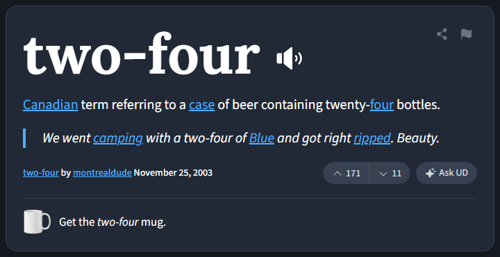

# claude-two-four

<a href="https://www.urbandictionary.com/define.php?term=two-four"></a>

A Claude Code marketplace with two independently installable plugins. `two-four` provides batch file edits, multi-pattern search, shell commands, GitHub Actions results, and Claude plan usage. `codex-agents` connects Claude to Codex subagents.

## Install

```
/plugin marketplace add andrew-from-toronto/claude-two-four
```

Install either plugin or both.

```
/plugin install two-four@claude-two-four
/plugin install codex-agents@claude-two-four
```

Needs Node 22 or later on the machine.

## Codex Agents

Install the [Codex CLI](https://developers.openai.com/codex/cli), make `codex` available on `PATH`, and sign in before delegating.

In Claude Code, type `@` and select `codex-agents:codex`, then give it a task. The background subagent appears in the terminal's subagent panel and in `/tasks`. Open its transcript or send it a follow-up through Claude's usual subagent controls. The Claude subagent relays messages and results while Codex does the assigned work. It reports the worker ID to the parent for direct mid-turn steering or interruption through the MCP tools.

The parent can also call the MCP tools directly.

| Tool | What it does |
| --- | --- |
| `codex_spawn` | Starts a background Codex subagent with its own conversation. Pass a prompt and optionally a name, working directory, model, or sandbox. |
| `codex_send` | Steers an active turn or sends a follow-up in the same conversation after the turn ends. |
| `codex_wait` | Reads commentary and answers as they become available. Start at cursor `0` and reuse `next_cursor` on later reads. Use `timeout_seconds: 0` to check immediately. |
| `codex_list` | Shows subagents and their current status. |
| `codex_stop` | Interrupts the active turn. Send a follow-up once it has stopped to continue the conversation. |

Claude can run several workers in parallel and address each by its ID. Workers are scoped to the current plugin session. The MCP tools provide the lifecycle and mailbox, so Claude receives updates through `codex_wait`. Codex defaults to a read-only sandbox and uses its configured model. Pass `sandbox: "workspace-write"` when the task calls for changes. Codex runs under its own sandbox with approval prompts disabled.

## Two-Four tools

### edit

An `edit` tool that creates and edits any number of files in a single call.

- Entries apply in order, so later edits see earlier ones, including several edits to the same file.
- All or nothing: if any entry fails, no file is written, and every failure comes back with its reason (plus the closest-matching lines when the search text isn't found).
- Search text must match exactly once unless `replace_all` is set. Curly vs straight quotes, dash variants, non-breaking spaces and CRLF vs LF count as equal when matching, and replacements keep the file's line endings.
- Omitting `old_string` creates a file (and its folders); it never overwrites an existing one.
- Writes go through symlinks and junctions to their targets instead of replacing the link.

### search

A `search` tool that runs several regex patterns over many files in one call.

- Paths can be files, directories or globs; directories in a git repo honour `.gitignore`.
- Results are grouped by pattern, then file, with line numbers and optional context.
- A leading `(?i)`, `(?m)` or `(?s)` is accepted as a flag, since JavaScript regex rejects it.
- Files that can't match are never split into lines, and reads run 64 at a time.

### run

`run` runs a command (pwsh or bash), saves the full interleaved output to a file under the temp folder, and returns the exit code plus a digest: the whole output if short, otherwise matching lines and the tail.

- The `dotnet-test` preset returns failed tests with their messages and first user-code stack frames, compiler errors, and run summaries, for both VSTest and Microsoft.Testing.Platform.
- A timeout or cancelling the call kills the whole process tree.
- While it runs, it sends progress every 30 seconds so Claude Code's idle timeout doesn't abort quiet long commands.

### ci

`ci` reads GitHub Actions results through the `gh` CLI.

- Takes a run or job URL, run id, PR (`#123` or URL), commit SHA (short ones are expanded) or branch.
- Shows the newest run per workflow, job counts, and for each failed step its `##[error]` lines and last log lines.
- Job logs are fetched per job and in parallel, then sliced to the failed step.
- `grep` searches the job logs instead (with context lines), and `jobs` picks which jobs by name, passing ones included.
- Completed jobs' logs are cached in the temp folder and their paths returned, so repeat searches skip the download and the files can be searched directly.

### usage

`usage` shows the account's plan usage, the same data as `/usage`.

- Session (5-hour) and weekly limit percentages with reset times, and extra-usage spend.
- Reads Claude Code's login token from `~/.claude/.credentials.json` (or `$CLAUDE_CONFIG_DIR`) and calls the undocumented `api.anthropic.com/api/oauth/usage` endpoint, so it may break if that endpoint changes.

## Develop

Run these commands from `plugins/two-four` or `plugins/codex-agents`.

```
pnpm install
pnpm test
pnpm build
```

Each plugin runs its committed `dist/server.mjs` bundle. Rebuild the affected bundle with each source change.
